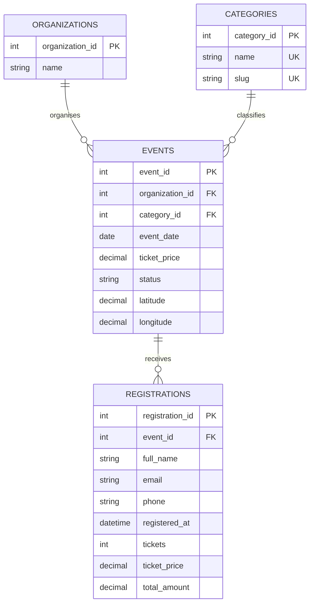

# Architecture and API reference

The browser loads HTML, styles, photographs and a local copy of AngularJS. Controllers request JSON through the `EventApi` service. Express validates requests and reads or writes MySQL. AngularJS updates the page from the response; event records are not hardcoded into HTML.

## Database



`registrations` has a composite unique key on `(event_id, email)`. The API trims and lowercases emails. This identifies returning visitors without a user account table: the same address can join different events, but only once per event. It does not verify email ownership.

The event foreign key uses `ON DELETE RESTRICT`. The API checks for registrations and returns a useful deletion message. Booking, editing and deletion lock the same event row inside a transaction. When booking and deletion compete, either the booking stays attached to an existing event or it is rejected after deletion. It cannot become an orphan.

Each registration stores the ticket price at booking time and its total. Later price changes do not rewrite old bookings. `fundingRaised` combines the event's recorded donations and the sum of booked ticket amounts. It is not a payment settlement figure.

The MySQL connection sets its session to UTC. Registration times are returned as ISO UTC strings; both websites display them in `Australia/Sydney`. Event dates and start/end times describe the local schedule. Public eligibility uses today's date in Sydney.

## Routes

Every route below begins with `/api`. Successful reads and updates return `200`, creation returns `201`, and deletion returns `204` with no body.

| Method and route | Result |
| --- | --- |
| `GET /health` | Database connectivity and app version |
| `GET /categories` | Category names and IDs |
| `GET /organizations` | Organiser names, IDs and summaries |
| `GET /events` | Active events dated today or later, ordered by date and time |
| `GET /events?date=YYYY-MM-DD&location=Bondi&category=1` | Combined filters; location searches suburb and venue |
| `GET /events/featured` | First four public events |
| `GET /events/:id` | Public event and all registrations, newest first |
| `POST /events/:id/registrations` | Validate and create a booking |
| `GET /admin/events` | Every event, including past and suspended records |
| `GET /admin/events/:id` | Staff details and registrations with contacts |
| `POST /admin/events` | Create an event |
| `PUT /admin/events/:id` | Update the event's editable fields |
| `DELETE /admin/events/:id` | Delete only when there are no registrations |
| `POST /admin/categories` | Create a category |
| `PUT /admin/categories/:id` | Update a category |
| `DELETE /admin/categories/:id` | Delete only when no event uses it |

The visitor registration list contains names, times, ticket counts and amounts. Emails and phones are returned only by the staff detail endpoint. Authentication is omitted as allowed by the assignment; the staff endpoint itself is accessible without sign-in.

Errors use JSON, for example:

```json
{
  "error": "Check the highlighted registration details.",
  "fields": { "tickets": "Enter a whole number between 1 and 20." }
}
```

Error statuses are `400` for invalid input, `404` for missing/unavailable resources, `409` for duplicates or protected deletion, `413` for oversized forms and `503` for service failure. Database error details and credentials are not returned to the browser.

## Booking flow

1. `registration.html?id=2` requests `GET /api/events/2` and displays that event.
2. AngularJS validates the named form. Invalid input shows a page alert and field messages without sending a booking.
3. The controller posts `fullName`, `email`, `phone` and `tickets`. The server validates them again.
4. The API locks the active event, reads its price, calculates the total and inserts the timestamped registration. Client-supplied totals or dates are not trusted.
5. The response supplies the reference and stored values. The page shows confirmation and links to the event and event list.

Three tickets at `$8.50` create a `$25.50` record. A second booking with the same email for that event returns `409`.

## AngularJS and weather

`assets/js/shared.js` defines the module, `$http` service and display helpers. Controllers have explicit dependency arrays. They use `$q` for asynchronous loading, `ng-model` for forms and `ng-repeat ... track by ...` for records. The API service translates request failures into visible messages. Both website packages include their own copies of shared assets.

The editor's form is named `editor.form`. Publishing it on the controller keeps it reachable across the `ng-if` child scope, so field validation and the unsaved-edit check read the same form state. AngularJS assigns named form controllers through its expression parser; see the [1.8.3 form directive source](https://github.com/angular/angular.js/blob/v1.8.3/src/ng/directive/form.js).

The weather request uses event coordinates, daily weather code and temperature extremes, a 16-day forecast and Sydney timezone. It chooses the row matching the event date. Dates outside that window show an explanation; failures leave the event and booking link usable. WMO code `3` means overcast—the brief's `2003` entry is a typo.

## Source map

| File | Responsibility |
| --- | --- |
| `api/schema.sql` | Tables, relationships, indexes and sample data |
| `api/event_db.js` | MySQL pool and UTC session setup |
| `api/validation.js` | IDs, dates, contacts, event fields and categories |
| `api/server.js` | REST routes, transactions, errors and static websites |
| `clientside/assets/js/shared.js` | API requests, formatting and navigation |
| `clientside/assets/js/app.js` | Public page controllers and weather |
| `adminside/assets/js/admin.js` | Staff list, editor and categories |
| `api/test/api.test.js` | Tests against dedicated MySQL data |

Primary references: [AngularJS 1.8.3 source and docs](https://github.com/angular/angular.js/tree/v1.8.3), [mysql2 documentation](https://sidorares.github.io/node-mysql2/docs), [Open-Meteo documentation](https://open-meteo.com/en/docs).
